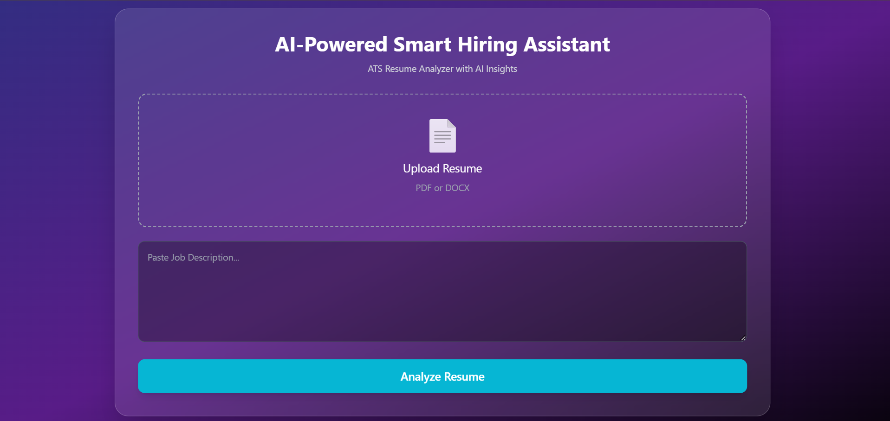
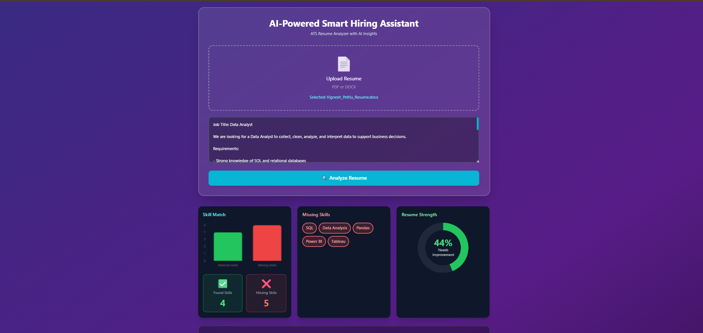
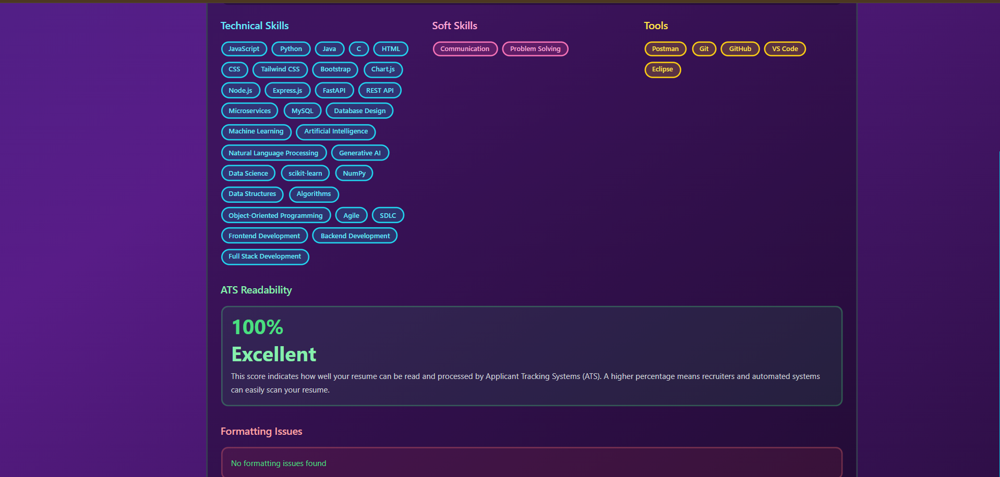
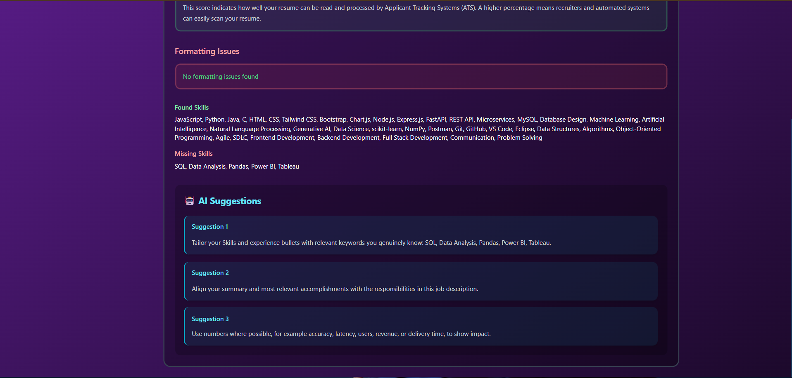
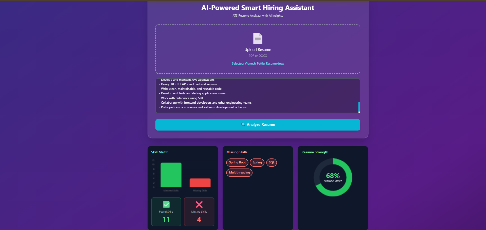

# 🤖 AI-Powered Smart Hiring Assistant

### ATS Resume Analyzer with AI Insights

An AI-powered web application that analyzes resumes against specific job descriptions, calculates ATS compatibility, identifies matching and missing skills, evaluates resume readability, and provides actionable improvement suggestions.

## 🚀 Live Demo

👉 https://resume-analyzer-ai-i9ft.onrender.com/

## 📂 Source Code

👉 https://github.com/Vignesh-130/Resume-Analyzer-AI

---

## ✨ Features

- 📄 Upload resumes in PDF and DOCX formats
- 🎯 Analyze resumes against a specific Job Description
- 📊 Job-dependent ATS Match Score
- 📈 Resume Readability / Strength Score
- 🔍 Identify matching and missing skills
- 🧠 Categorize technical, soft, and tool skills
- ⚠️ Detect resume formatting and ATS readability issues
- 🤖 AI-powered improvement suggestions using Groq
- 📊 Interactive charts using Chart.js
- 🔒 Environment-based API key configuration
- 🌐 Live deployment using Render

---

## 📸 Application Screenshots

### 🏠 Dashboard



### 📊 ATS Analysis Results



### 🧠 Skills Analysis



### 🤖 AI-Powered Suggestions



### 🎯 Score Analysis



---

## 🎯 Project Overview

The AI-Powered Smart Hiring Assistant is designed to help job seekers understand how well their resume matches a specific job description.

Unlike a fixed resume scoring system, the application separates **resume quality** from **job-specific compatibility**.

The same resume can receive different ATS Match Scores when evaluated against different job descriptions.

### Example

```text
Resume + Java Full Stack JD
          ↓
      ATS Match Score
          ↓
Resume + Python Developer JD
          ↓
      Different Score


## Block 2: Candidate ranking and categorization

Batch screening accepts a job description, number of candidates to select, minimum job-match score (0–100), and minimum matched-skill count. Successful analyses are ranked by match score (ties are resolved by filename for repeatable ordering). Candidates are categorized as **Selected**, **Eligible but Not Selected**, or **Low Match**; invalid, unreadable, and duplicate files are categorized as **Processing Failed** (duplicates are explained separately). The dashboard provides category counts, filename search, status filtering, selection explanations, candidate detail views, and CSV export. These rules are configurable and should be reviewed for job relevance and fairness; scores are decision support, not automatic hiring decisions.

## Groq API key

Do not add the API key to source code or commit a real `.env` file. When all blocks are complete, create a local `.env` file from `.env.example` and add your own key as `GROQ_API_KEY=...`. The `.env` file is ignored by Git. Keep the key private and rotate it if it was exposed.

## Block 3 — Candidate Details, Reports & Dashboard

- Batch candidate **View Details** shows the existing analysis payload for that specific candidate, including readability/match/overall scores, matched and missing skills, technical/tool/soft skills, keyword counts, detected resume sections/contact signals, formatting issues, suggestions, and an extracted-text preview.
- **Export CSV** downloads batch ranks, scores, screening statuses, selection explanations, matched/missing skills, and processing errors.
- The recruiter dashboard visualizes candidate status breakdown and match-score bands using Chart.js.
- Batch processing history stores only aggregate counts and timestamps in the current browser (`localStorage`), with a Clear history control. It does not save candidate filenames, resume text, or job descriptions. Clearing browser data or switching browsers/devices clears or separates this history.
- Automated scoring-separation tests use `tests/fixtures/synthetic-resume.docx`; they do not need private files in `uploads/`.

### Testing

Run `npm install` followed by `npm test`. The test script checks JavaScript syntax and verifies that readability is independent of the job description and repeated identical inputs return the same scores. The fixture is synthetic and is intended for repeatable automated testing, not as evidence of real-world hiring accuracy.


## Block 4: Security, performance and testing

- Resume uploads are held in memory and are not written to an uploads folder by this server. Avoid logging resume contents, extracted text, API keys, or full parser errors.
- `.env` is ignored by Git. Keep `GROQ_API_KEY` private; use `.env.example` as a template and never commit the populated `.env` file.
- Uploads accept PDF/DOCX only, with a 5 MB per-file limit and a maximum of 20 files per batch. Basic file signatures are checked before extraction.
- Batch files are analyzed sequentially to cap parser/AI concurrency, and simultaneous batch requests are limited by `MAX_ACTIVE_BATCHES` (default 2). Upload endpoints also have a basic per-IP request throttle.
- HTTP security headers are set; responses involving candidate analysis use `Cache-Control: no-store`. Same-origin local use is the default. Configure `CORS_ORIGIN` only for a trusted separate frontend origin.
- The optional Python AI service is not called by the current Node.js request path, so it is intentionally not started as part of the default workflow. Groq enrichment is optional and deterministic suggestions remain available when no key is configured.

Run the checks from the folder containing `package.json`:

```bash
npm install
npm test
npm start
```

The automated test checks that readability is stable across different job descriptions, repeated identical inputs produce the same scores, security response headers are present, duplicate batch files are detected, and the shortlist limit is respected. It uses only the committed synthetic DOCX fixture, not private resumes. These checks are a baseline and do not prove production security or hiring validity.


## Block 5 — AI Career & Skill Recommendations

Candidate details include an English/Telugu/Hindi career guidance action. It uses missing/matched skills to generate a short learning roadmap, course-topic suggestions, and a cautious job-suitability explanation. When `GROQ_API_KEY` is configured, Groq can provide AI-assisted wording; otherwise, deterministic multilingual fallback guidance is returned. The guidance endpoint sends skill lists and a limited job-description excerpt to Groq, not the resume text or contact details. Do not treat generated guidance as a hiring decision, and verify course offerings before enrolling.

Batch candidate skill badges use the same visual categories as the single-resume screen: technical skills are cyan, soft skills are pink, and tools are yellow. Missing skills use the known job-skill category when available.
